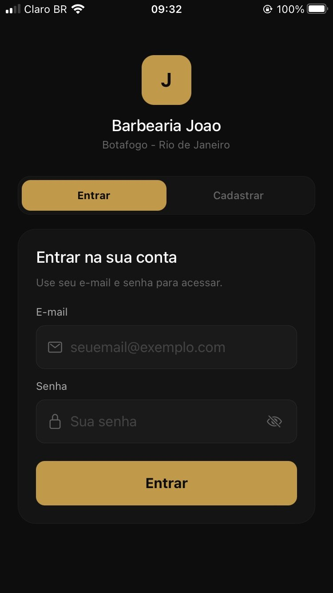
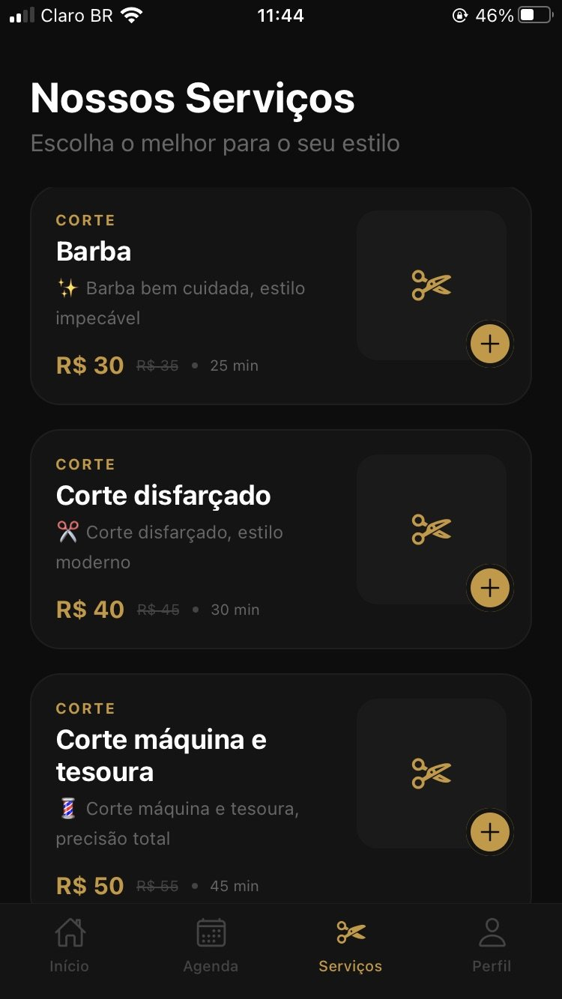
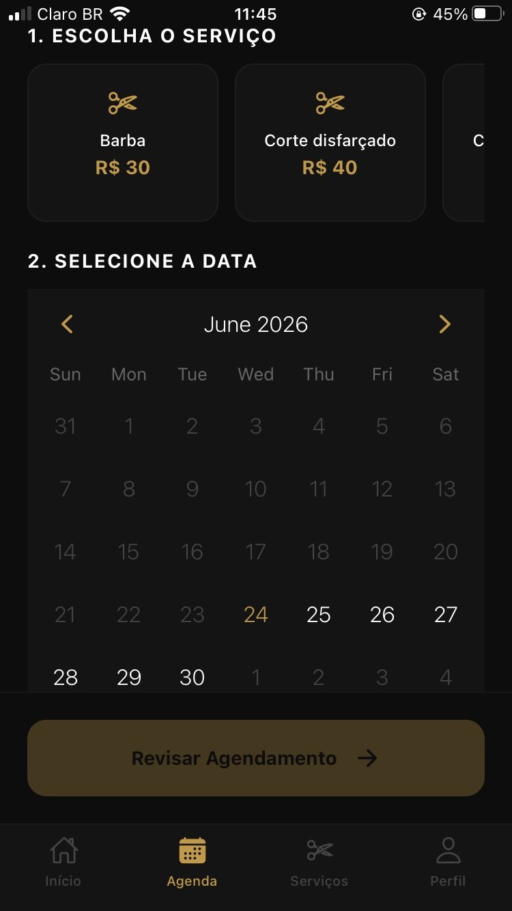
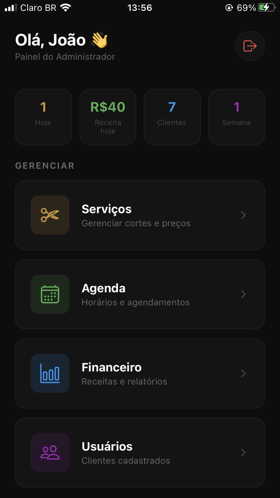
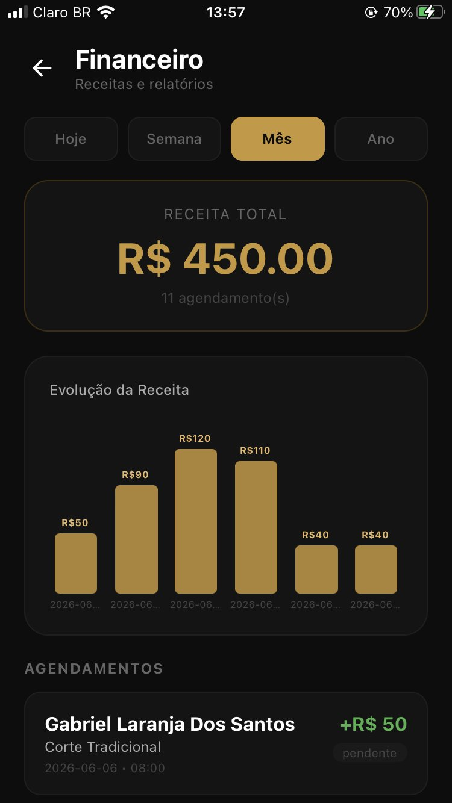

# Olá, eu sou o Gabriel Laranja 👋

🎓 Estudante de **Análise e Desenvolvimento de Sistemas (UNISUAM)** e **Sistemas de Computação (UFF)**, no Rio de Janeiro.

💻 Desenvolvedor em formação, construindo projetos práticos em mobile, web e banco de dados. Já desenvolvi um app mobile com painel administrativo, um sistema web de pedidos e um jogo web, e agora estou aprofundando **React** e **Node.js**.

🤝 **Busco uma oportunidade de estágio em desenvolvimento** para aprender com uma equipe experiente e evoluir como desenvolvedor.

---

## 🛠️ Tecnologias

**Front-end e mobile**

**Back-end e banco de dados**

**Ferramentas**

---

## 📌 Projetos em destaque

### ✂️ [App Barbearia do João](https://github.com/GabrielLaranja7/Projeto_App_Barbearia)

Aplicativo mobile de agendamento e gestão para barbearia, com área do cliente e painel administrativo para o barbeiro.

- 📅 Agendamento em 3 passos: serviço, data e horário
- 💈 CRUD de serviços, agenda e controle financeiro com gráfico
- 👤 Cadastro e busca de clientes
- 🌗 Tema claro/escuro e ajuste de tamanho da fonte

**Stack:** `React Native` `Expo` `TypeScript` `Zustand` `Firebase Firestore`

  
  
  
  
  

---

### 🍽️ [Sabor & Arte](https://github.com/GabrielLaranja7/Projeto_Sabor-arte)

Sistema web gastronômico com cardápio digital, pedidos e painel administrativo.

- 🍕 Cardápio digital
- 🛒 Sistema de pedidos
- 🖥️ Painel administrativo
- 🗄️ Integração com banco de dados SQL

**Stack:** `PHP` `SQL` `JavaScript` `HTML` `CSS`

  
  
  

---

### 🎮 [Projeto Extensão: Jogo](https://github.com/GabrielLaranja7/Projeto_extens-o_jogo)

Jogo web desenvolvido com HTML, CSS e JavaScript. **(Escreva aqui 1 ou 2 linhas sobre o jogo: objetivo, como se joga.)**

**Stack:** `HTML` `CSS` `JavaScript`

  
  

---

## 📊 GitHub Stats

---

## 📫 Contato

  Sempre aprendendo, sempre evoluindo 🚀

